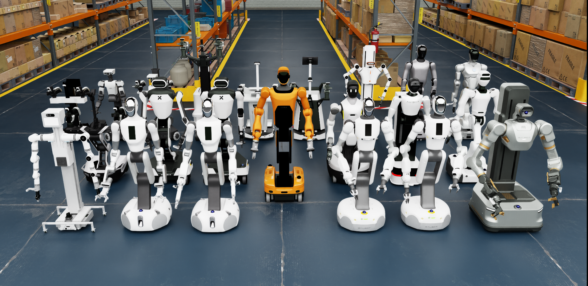
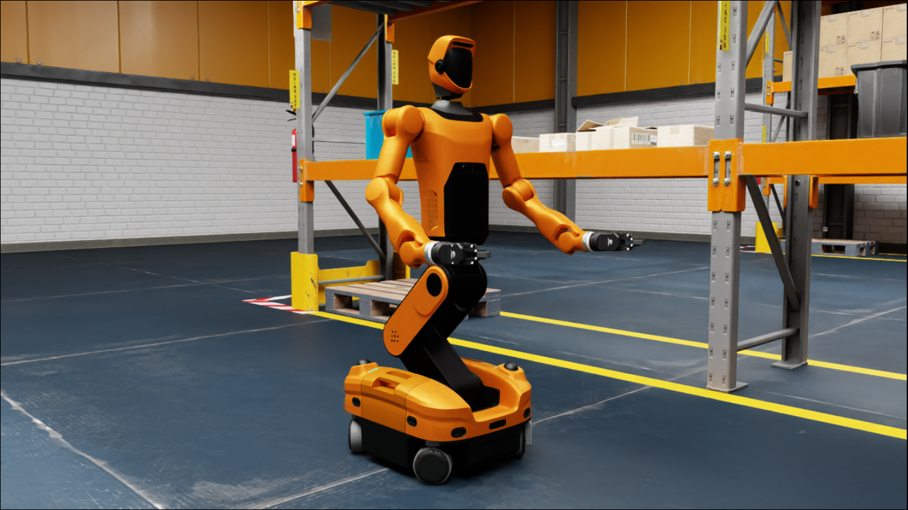
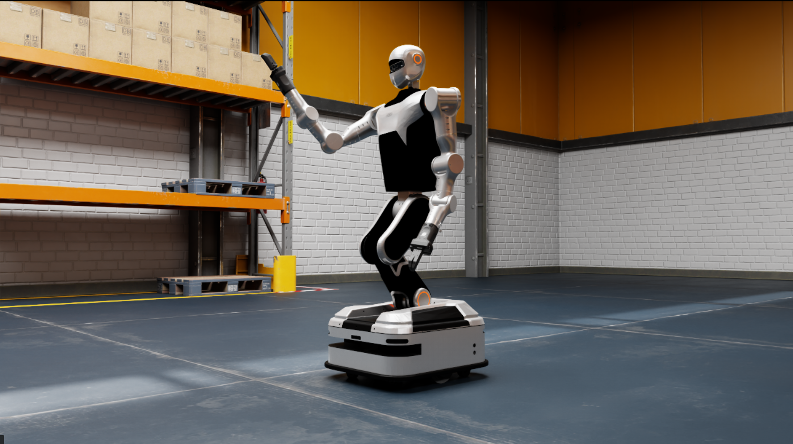

# FiveAges Sim

**Docs** (Sphinx, bilingual): **[English](https://fiveages-sim.github.io/docs/)** · **[中文](https://fiveages-sim.github.io/docs/zh_CN/)**

[English](#english) · [中文](#中文)

 

## English

FiveAges Sim is a multi-repository ROS 2 stack for **descriptions**, **Hardware Interfaces**, OCS2 MPC (split-body / full-body), **Gazebo** and **FaSim** (Isaac Sim + the same ROS 2 motion stack as hardware), teleop, and Python tooling.

Public entry: [open-deploy-ws](https://github.com/fiveages-sim/open-deploy-ws) (ROS 2 Jazzy). Internal workspace `fa-deploy-ws` is not public.

## 中文

FiveAges Sim 是一套面向描述、**驱动层**、OCS2 分体/全身控制、Gazebo 与 FaSim（Isaac Sim + 与真机同一套 ROS 2 运控）、遥操作和 Python 工具的 ROS 2 多仓库技术栈。

公开入口：[open-deploy-ws](https://github.com/fiveages-sim/open-deploy-ws)（ROS 2 Jazzy）。内部工作空间 `fa-deploy-ws` 未公开。

---

## Quick Deploy

| Repository | EN | 中文 |
|---|---|---|
| [docs](https://github.com/fiveages-sim/docs) | Sphinx documentation source | 文档源码仓 |
| [open-deploy-ws](https://github.com/fiveages-sim/open-deploy-ws) | Public ROS 2 workspace. Lean branches: `dobot-cr5`, `arx-lift2s`, `panthera-ht`. | 公开 ROS 2 工作空间。精简分支：`dobot-cr5`、`arx-lift2s`、`panthera-ht`。 |
| [fa-py-libraries](https://github.com/fiveages-sim/fa-py-libraries) | Shared Python libraries | 常用 Python 库 |
| `fa-deploy-ws` | Internal only (not a public repo) | 内部工作空间（未公开） |

## ROS2 Control & Descriptions

| Repository | EN | 中文 |
|---|---|---|
| [robot_descriptions](https://github.com/fiveages-sim/robot_descriptions) | URDF/xacro umbrella | 描述聚合仓 |
| [robot-descriptions-common](https://github.com/fiveages-sim/robot-descriptions-common) | Grippers, hands, sensors, `robot_common_launch` | 夹爪 / 灵巧手 / 传感器 / 公共 launch |
| [robot-descriptions-dobot](https://github.com/fiveages-sim/robot-descriptions-dobot) | Dobot CR series | 越疆 CR 系列 |
| [robot-descriptions-arx](https://github.com/fiveages-sim/robot-descriptions-arx) | ARX X5; Acone / AC One (dual-arm); Lift 2S (full-body) | 方舟 X5；Acone / AC One（双臂）；Lift 2S（全身） |
| [robot-descriptions-ht](https://github.com/fiveages-sim/robot-descriptions-ht) | HighTorque Panthera HT | 高擎 Panthera HT |
| [robot-descriptions-galbot](https://github.com/fiveages-sim/robot-descriptions-galbot) | Galbot descriptions | 银河通用描述 |
| [robot-descriptions-quadruped](https://github.com/fiveages-sim/robot-descriptions-quadruped) | Quadruped descriptions | 四足描述 |
| [arms_ros2_control](https://github.com/fiveages-sim/arms_ros2_control) | Controllers and teleop for single-arm, dual-arm, and wheeled-arm humanoids | 单臂 / 双臂 / 轮臂人形的控制器与遥操作 |
| [drag_teleop_controller](https://github.com/fiveages-sim/drag_teleop_controller) | Isomorphic master–slave drag teleop | 同构主从拖动遥操作 |

## Hardware Interfaces / 驱动层

| Repository | EN | 中文 |
|---|---|---|
| [arx-ros2-control](https://github.com/fiveages-sim/arx-ros2-control) | ARX Hardware Interface | 方舟驱动层 |
| [dobot-cr-ros2-control](https://github.com/fiveages-sim/dobot-cr-ros2-control) | Dobot CR Hardware Interface | 越疆 CR 驱动层 |
| [ht-ros2-control](https://github.com/fiveages-sim/ht-ros2-control) | HighTorque Panthera HT Hardware Interface | 高擎 Panthera HT 驱动层 |
| [unitree-ros2-control](https://github.com/fiveages-sim/unitree-ros2-control) | Unitree SDK2 Hardware Interface | 宇树 SDK2 驱动层 |
| [marvin-ros2-control](https://github.com/fiveages-sim/marvin-ros2-control) | Tianji Hardware Interface | 天机驱动层 |
| [modbus-ros2-control](https://github.com/fiveages-sim/modbus-ros2-control) | RS485 / Modbus grippers | RS485 / Modbus 夹爪 |
| [can-ros2-control](https://github.com/fiveages-sim/can-ros2-control) | CAN / CAN FD hands | CAN / CAN FD 灵巧手 |
| [juxie-ros2-control](https://github.com/fiveages-sim/juxie-ros2-control) | JX CAN FD motor Hardware Interface | JX CAN FD 电机驱动层 |

## Python Tools

| Repository | EN | 中文 |
|---|---|---|
| [ros2_robot_interface](https://github.com/fiveages-sim/ros2_robot_interface) | Topic-based ROS 2 robot API | ROS 2 高层接口 |
| [ros2-viser](https://github.com/fiveages-sim/ros2-viser) | Viser GUI for ROS 2 | Viser 可视化 |
| [lerobot_ros2](https://github.com/fiveages-sim/lerobot_ros2) | LeRobot ↔ ROS 2 | LeRobot 与 ROS 2 |
| [robot_action_composer](https://github.com/fiveages-sim/robot_action_composer) | Task-queue YAML / motion generation | 任务队列与运动编排 |
| [wuji-retargeting](https://github.com/fiveages-sim/wuji-retargeting) | Wuji hand retargeting (org mirror) | 舞肌手部重定向（组织镜像） |
| [gym-hil](https://github.com/fiveages-sim/gym-hil) | Human-in-the-loop RL suite | 人在回路强化学习 |

## Simulation

| Repository | EN | 中文 |
|---|---|---|
| [FaSim-Isaac](https://github.com/fiveages-sim/FaSim-Isaac) | Isaac Sim deploy scripts / FaSim entry | Isaac Sim 部署与 FaSim 入口 |
| [robot_usds](https://github.com/fiveages-sim/robot_usds) | Isaac USD superproject | 机器人 USD 聚合 |
| [galbot-usds](https://github.com/fiveages-sim/galbot-usds) | Galbot USD assets | 银河通用 USD |
| [fiveages-env-usds](https://github.com/fiveages-sim/fiveages-env-usds) | Environment USDs | 场景 USD |
| [maniskill_models](https://github.com/fiveages-sim/maniskill_models) | ManiSkill models | ManiSkill 模型 |
| [robosuite_models](https://github.com/fiveages-sim/robosuite_models) | Robosuite / MuJoCo models | Robosuite（MuJoCo）模型 |

## Navigation & data

| Repository | EN | 中文 |
|---|---|---|
| [internnav_arx_lift2s](https://github.com/fiveages-sim/internnav_arx_lift2s) | InternNav on ARX Lift 2S (full-body) | InternNav 部署到 ARX Lift 2S（全身） |
| [socialgen_w2](https://github.com/fiveages-sim/socialgen_w2) | Social-nav trajectory generation for W2 | W2 社交导航轨迹生成 |
| [Arena_W2](https://github.com/fiveages-sim/Arena_W2) | Arena / GRScenes launch for W2 | W2 的 Arena / GRScenes 启动 |
| [scenarios_generate](https://github.com/fiveages-sim/scenarios_generate) | GRScenes `scenario.yaml` authoring | GRScenes 场景脚本生成 |
